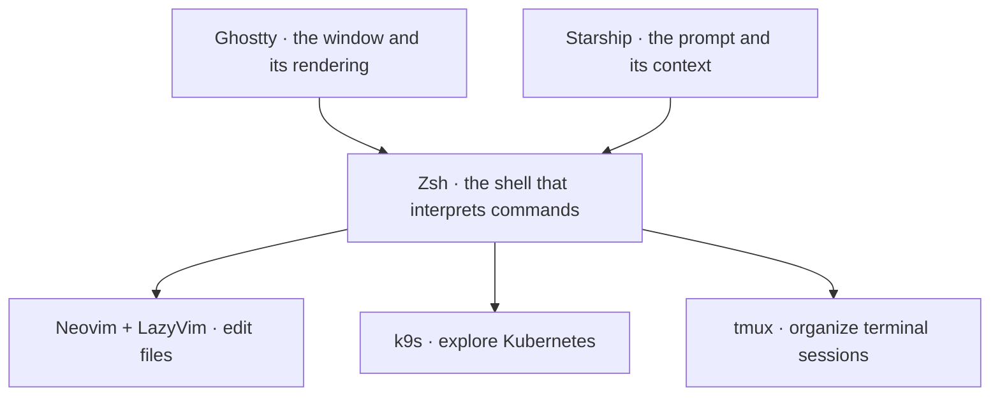

# Kai Finds · dotfiles

[](https://github.com/Kai-Finds) [](LICENSE)  

**Understand your terminal, then make it yours.**
A macOS / Apple Silicon setup you can read, try one file at a time, and bend to your habits.

Our settings for **Ghostty, Zsh, Starship, Neovim and k9s**, plus a few supporting tools. The apps belong to their upstream projects. What we add: the settings, shortcuts, themes and integrations we picked, each one explained.

[Start installing](docs/installation.md) · [Explore the guides](docs/README.md) · [Browse the file inventory](docs/inventaire.md)

## Worth it, or skip it?

**✅ Worth it if**
- you're on a Mac and want to adopt one config at a time, with a diff before anything changes
- you want one palette (Catppuccin Mocha) across Ghostty, Starship, Neovim, k9s, tmux, bat, btop and Zed
- you work with Kubernetes and want k9s and Neovim wired together

**❌ Skip it if**
- you're on Linux or Windows: this is a macOS snapshot, and some options behave differently elsewhere
- you want one command that sets up a whole machine: adoption is gradual on purpose, and Zsh plugins, TPM and several k9s tools install separately

## What does each tool do?

Open a terminal and several programs work together:



A Ghostty theme changes the window's appearance. Starship changes the prompt before a command. Neovim and k9s then provide their own interfaces and settings.

## Upstream applications and our configuration

| Upstream project | What it provides | What our dotfiles configure | Guide |
| --- | --- | --- | --- |
| [Ghostty](https://ghostty.org/docs) | A terminal emulator with tabs and splits | Catppuccin Mocha, 85% opacity, 20 pt font, macOS shortcuts | [Ghostty](docs/guides/ghostty.md) |
| [Zsh](https://www.zsh.org/) | The shell, its language, and command-line editing | Modules, Git/Kubernetes aliases, navigation, and functions | [Shell](docs/guides/shell.md) |
| [Starship](https://starship.rs/) | A customizable prompt engine | Mocha palette, short paths, Git branch and status | [Shell](docs/guides/shell.md) |
| [Neovim](https://neovim.io/) + [LazyVim](https://www.lazyvim.org/) | The editor and a preconfigured plugin foundation | Oil instead of a sidebar, a quieter interface, a transparent theme, and k9s integration | [Neovim](docs/guides/neovim.md) |
| [k9s](https://k9scli.io/) | A terminal interface for Kubernetes | Catppuccin Mocha, DevOps columns, aliases, jumps, and external commands | [k9s](docs/guides/k9s.md) |
| [tmux](https://github.com/tmux/tmux/wiki) | Terminal sessions, windows, and panes | Ctrl-A prefix, splits, top status bar, and macOS clipboard integration | [Other tools](docs/guides/autres-outils.md) |

Completion, LSP support, diagnostics, Kubernetes views, and plugin capabilities come from the upstream projects. The guides distinguish that foundation from the choices made in this repository.

## What does this look like in daily use?

- **Navigate a project:** Zsh interprets `gst`, our alias calls `git status`, and Starship shows the branch and changes.
- **Edit without a permanent sidebar:** Neovim opens a file, `-` opens Oil to browse its directory, and `Space z` temporarily enables Zen mode.
- **Inspect Kubernetes:** k9s displays resources; our columns highlight images, resource usage, and status. Plugins call external tools that are already installed.
- **Organize a session:** Ghostty splits divide the application window; tmux also provides its own sessions and panes inside the terminal.

## Adopt only what you need

This repository uses [chezmoi](https://www.chezmoi.io/) to copy settings to their destinations. You can start with one file:

```sh
git clone https://github.com/Kai-Finds/dotfiles.git
cd dotfiles
# Prerequisite: chezmoi is installed. This command does not change your settings.
chezmoi --source "$PWD" diff ~/.config/starship.toml
```

After reviewing the diff and backing up your settings, apply that file with `chezmoi --source "$PWD" apply ~/.config/starship.toml`. Starship must also be installed and initialized in your shell to display the prompt.

The [installation guide](docs/installation.md) covers dependencies, isolated checks, gradual adoption, and private files. The [adaptation guide](docs/adaptation.md) explains differences from the original machine and how to roll back.

## Before you start

The shared snapshot contains configuration and license files without keys or account access. The Brewfile installs selected tools; Zsh plugins, TPM, and several k9s utilities require separate installation. Neovim downloads its plugins on first launch.

Catppuccin Mocha is the shared palette across the themed applications. Each application implements its own interface, so matching the palette does not make every screen identical. Adjust font sizes and transparency in each application's configuration.

k9s retains `readOnly: false`. Its debugging shortcuts can create resources, and one shortcut displays Secret contents. The [k9s guide](docs/guides/k9s.md) explains each command before use.

## Browse and contribute

| Location | Contents |
| --- | --- |
| [`home/`](home/README.md) | Settings with a README in every directory; chezmoi turns `dot_` into `.` |
| `docs/guides/` | Upstream applications, our choices, and shortcuts |
| `docs/inventaire.md` | Detected dotfiles and the distributed file list |
| `examples/` | Templates for Git identity and private settings |
| `tests/` | Installation into a temporary HOME and isolated Zsh startup |
| `Brewfile` | Selected macOS tools |

A useful contribution explains the need, the setting being changed, and its dependencies. Before proposing a change:

```sh
python3 tests/verify.py
gitleaks dir . --redact
```

To illustrate the guides with real screens, follow the [Ghostty capture guide](docs/captures.md). Text examples explain interactions; they are not screenshots or proof of graphical behavior.

## Credits and license

Thanks to the maintainers of the linked projects, [Catppuccin](https://github.com/catppuccin/catppuccin), and the plugin authors referenced in our files. This repository distributes configuration, not the applications themselves.

Apache-2.0; third-party components retain their respective licenses. Bundled Catppuccin theme sources are pinned in [theme-sources.json](docs/theme-sources.json), with their MIT notices in [docs/licenses/](docs/licenses/).

---

<div align="center">

<sub><b>Kai Finds</b> · Do more with AI · The AI tools that turn one person into a team.<br>
Sourced. No hype. Every claim here points to something you can check.<br>
<a href="https://kaifinds.sabaidev.la">kaifinds.sabaidev.la</a> · <a href="https://www.threads.com/@kaifinds.ai">Threads</a> · <a href="https://www.facebook.com/122105394627540019">Facebook</a> · <a href="https://github.com/Kai-Finds">All repos</a></sub>

</div>
