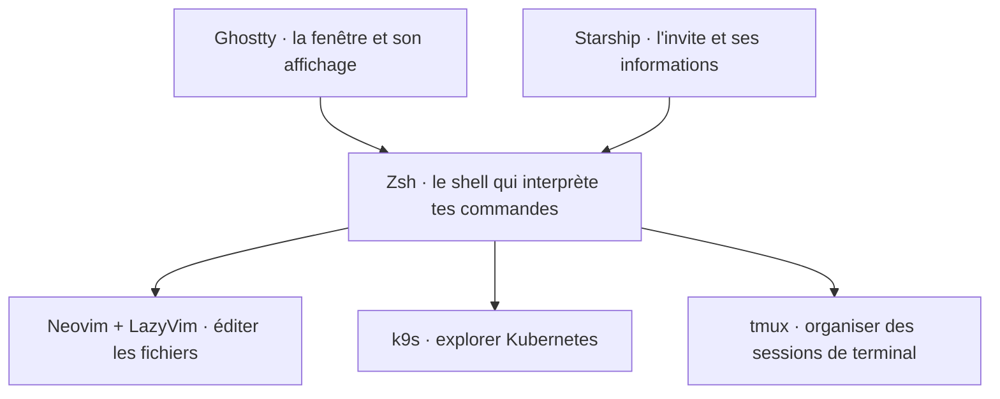

# Kai-Finds · dotfiles

**Comprendre son terminal, puis le personnaliser.** Une configuration macOS / Apple Silicon à explorer, reprendre par morceaux et adapter à ses habitudes.

Ce dépôt partage nos réglages pour **Ghostty, Zsh, Starship, Neovim et k9s**, ainsi que quelques outils complémentaires. Les logiciels sont développés par leurs projets respectifs ; notre contribution est le choix de leurs réglages, raccourcis, thèmes et intégrations.

[Commencer l'installation](docs/installation.md) · [Explorer les guides](docs/README.md) · [Voir tous les fichiers](docs/inventaire.md)

## Qui fait quoi ?

Quand tu ouvres un terminal, plusieurs logiciels travaillent ensemble :



Un thème Ghostty change l'affichage de la fenêtre. Starship change l'invite qui précède une commande. Neovim et k9s ont ensuite leur propre interface et leurs propres réglages.

## Le logiciel d'origine et notre configuration

| Projet d'origine | Ce qu'il fournit | Ce que nos dotfiles configurent | Guide |
| --- | --- | --- | --- |
| [Ghostty](https://ghostty.org/docs) | Un émulateur de terminal, avec onglets et splits | Catppuccin Mocha, opacité 85 %, police 20 pt, raccourcis macOS | [Ghostty](docs/guides/ghostty.md) |
| [Zsh](https://www.zsh.org/) | Le shell, son langage et l'édition des commandes | Modules, alias Git/Kubernetes, navigation et fonctions | [Shell](docs/guides/shell.md) |
| [Starship](https://starship.rs/) | Un moteur d'invite personnalisable | Palette Macchiato, chemin court, branche et état Git | [Shell](docs/guides/shell.md) |
| [Neovim](https://neovim.io/) + [LazyVim](https://www.lazyvim.org/) | L'éditeur et une base de plugins déjà configurée | Oil à la place de la sidebar, interface allégée, thème transparent et intégration k9s | [Neovim](docs/guides/neovim.md) |
| [k9s](https://k9scli.io/) | Une interface terminal pour Kubernetes | TokyoNight, colonnes DevOps, alias, jumps et commandes externes | [k9s](docs/guides/k9s.md) |
| [tmux](https://github.com/tmux/tmux/wiki) | Des sessions, fenêtres et panneaux de terminal | Préfixe Ctrl-A, splits, barre supérieure et copie macOS | [Autres outils](docs/guides/autres-outils.md) |

Les complétions, LSP, diagnostics, vues Kubernetes et possibilités de plugins viennent des projets d'origine. Les guides distinguent ce socle des choix présents dans ce dépôt.

## À quoi ça sert au quotidien ?

- **Naviguer dans un projet** : Zsh interprète `gst`, notre alias appelle `git status`, Starship affiche la branche et les changements.
- **Éditer sans sidebar permanente** : Neovim ouvre un fichier, `-` ouvre Oil pour parcourir son répertoire, `Espace z` active ponctuellement le mode Zen.
- **Lire un état Kubernetes** : k9s affiche les ressources ; nos colonnes mettent notamment images, consommation et état en évidence. Les plugins donnent accès aux outils externes déjà installés.
- **Organiser une session** : les splits Ghostty divisent la fenêtre ; tmux propose aussi ses propres sessions et panneaux à l'intérieur du terminal.

## Adopter seulement ce qui t'intéresse

Le dépôt utilise [chezmoi](https://www.chezmoi.io/) pour copier les réglages à leur destination. Tu peux commencer par un seul fichier :

```sh
git clone https://github.com/Kai-Finds/dotfiles.git
cd dotfiles
# Prérequis : chezmoi installé. Cette commande ne modifie pas tes réglages.
chezmoi --source "$PWD" diff ~/.config/starship.toml
```

Après lecture du diff et sauvegarde, appliquer ce fichier avec `chezmoi --source "$PWD" apply ~/.config/starship.toml`. Pour voir le prompt, Starship doit aussi être installé et initialisé dans ton shell.

Le [guide d'installation](docs/installation.md) explique les dépendances, le test isolé, l'application progressive et les fichiers privés. Le [guide d'adaptation](docs/adaptation.md) décrit les différences avec la machine d'origine et le retour arrière.

## À savoir avant de commencer

Ce partage contient **41 fichiers de configuration et de licence**, sans clés ni accès aux comptes. Le Brewfile installe une sélection d'outils ; les plugins Zsh, TPM et plusieurs utilitaires k9s demandent une installation séparée. Neovim télécharge ses plugins au premier lancement.

Les préférences sont personnelles : Ghostty et Neovim utilisent Mocha, Starship Macchiato, k9s TokyoNight. Ce ne sont pas des couleurs identiques. La taille de police et la transparence peuvent être adaptées dans chaque fichier.

k9s conserve `readOnly: false`. Ses raccourcis de debug peuvent créer des ressources, et un raccourci affiche le contenu des Secrets. Le [guide k9s](docs/guides/k9s.md) détaille chaque commande avant utilisation.

## Parcourir et contribuer

| Dossier | Contenu |
| --- | --- |
| [`home/`](home/README.md) | Réglages avec un README par dossier ; chezmoi transforme `dot_` en `.` |
| `docs/guides/` | Origine des logiciels, nos choix et raccourcis |
| `docs/inventaire.md` | Inventaire des dotfiles détectés et liste distribuée |
| `examples/` | Modèles pour l'identité Git et les réglages privés |
| `tests/` | Application dans un HOME temporaire et démarrage isolé de Zsh |
| `Brewfile` | Sélection d'outils macOS |

Une bonne contribution explique le besoin, le réglage modifié et ses dépendances. Avant de proposer une modification :

```sh
python3 tests/verify.py
gitleaks dir . --redact
```

Pour illustrer les guides avec de vrais écrans, suivre le [guide de capture Ghostty](docs/captures.md). Les exemples textuels des guides expliquent les gestes ; ils ne constituent pas des captures ou une preuve de fonctionnement graphique.

## Crédits et licence

Merci aux mainteneurs des projets cités, à [Catppuccin](https://github.com/catppuccin/catppuccin) et aux auteurs des plugins référencés dans nos fichiers. Ce dépôt distribue une configuration, pas les logiciels eux-mêmes.

Apache-2.0 ; les composants tiers conservent leurs licences respectives.
