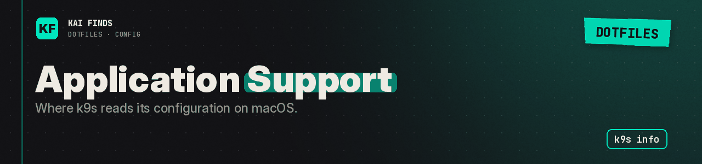

# Application Support: k9s configuration

[← Home](../../../README.md) · [Upstream project: k9s](https://k9scli.io/topics/config/) · [Detailed guide](../../../docs/guides/k9s.md)

On macOS, k9s can read its configuration from `~/Library/Application Support/k9s`. We keep that location instead of forcing a Linux-style path under `.config`.

Run `k9s info` to see the paths on your machine. The `k9s/` subdirectory holds its README, the shared files and the theme. Nothing else from the machine's Application Support is copied here.

## Apply these settings

Read the [installation guide](../../../docs/installation.md) and review the chezmoi diff before applying. READMEs stay in the repository; chezmoi never installs them.

---

<b>Kai Finds</b> · Do more with AI · <a href="https://github.com/Kai-Finds">github.com/Kai-Finds</a> · <a href="https://kaifinds.sabaidev.la">kaifinds.sabaidev.la</a>
