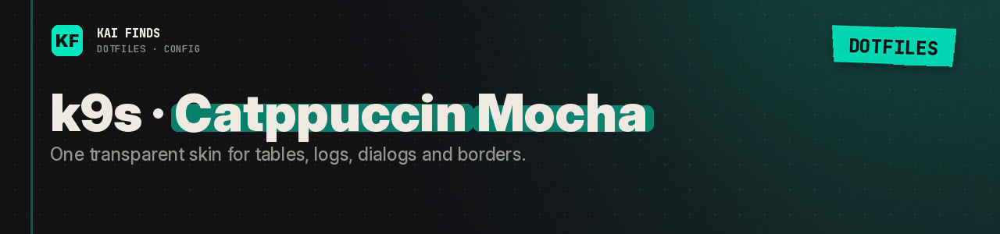

# k9s: the Catppuccin Mocha theme

[← Home](../../../../../README.md) · [Upstream project: k9s and Catppuccin](https://k9scli.io/topics/skins/) · [Detailed guide](../../../../../docs/guides/k9s.md)

k9s supports skins. Our `catppuccin-mocha-transparent.yaml` colors tables, prompts, logs, dialogs and borders, on a transparent background.

The parent `config.yaml` selects it with `ui.skin: catppuccin-mocha-transparent`. Copying the file without that line does nothing.

Destination: `~/Library/Application Support/k9s/skins/catppuccin-mocha-transparent.yaml`. Mocha matches Ghostty and Starship, but each app keeps its own interface. The skin changes no columns, no Kubernetes permissions and no commands.

## Apply these settings

Read the [installation guide](../../../../../docs/installation.md) and review the chezmoi diff before applying. READMEs stay in the repository; chezmoi never installs them.

---

<b>Kai Finds</b> · Do more with AI · <a href="https://github.com/Kai-Finds">github.com/Kai-Finds</a> · <a href="https://kaifinds.sabaidev.la">kaifinds.sabaidev.la</a>
