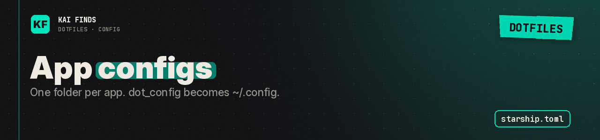

# Application configurations

[← Home](../../README.md) · [Upstream project: chezmoi](https://www.chezmoi.io/) · [Detailed guide](../../docs/README.md)

One subdirectory per app. chezmoi turns `dot_config` into `~/.config`.

| Item | Purpose |
| --- | --- |
| `starship.toml` | Catppuccin Mocha prompt, short paths, Git branch and status |
| `zsh/` | Shell modules and aliases |
| `ghostty/` | Terminal window appearance and shortcuts |
| `nvim/` | Neovim configuration based on LazyVim |
| `bat/`, `btop/`, `git/`, `zed/` | Independent preferences, explained in each README |

Starship draws the prompt. Our file picks its palette and modules. Install Starship and initialize it in your shell: our Zsh config does that in `plugins.zsh`.

The prompt hides hostname, time, memory and Kubernetes context. Language indicators depend on the project and the tools installed. Read `starship.toml` to change any of it.

Try Starship alone from the clone's root: `chezmoi --source "$PWD" diff ~/.config/starship.toml`, back up yours, then apply. No need to take every directory at once.

## Apply these settings

Read the [installation guide](../../docs/installation.md) and review the chezmoi diff before applying. READMEs stay in the repository; chezmoi never installs them.

---

<b>Kai Finds</b> · Do more with AI · <a href="https://github.com/Kai-Finds">github.com/Kai-Finds</a> · <a href="https://kaifinds.sabaidev.la">kaifinds.sabaidev.la</a>
