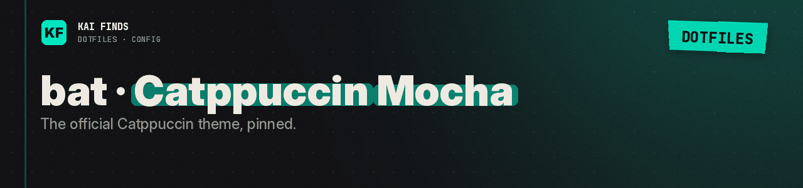

# bat · Catppuccin Mocha

[← Application configuration](../README.md) · [Upstream theme](https://github.com/catppuccin/bat)

`Catppuccin Mocha.tmTheme` is the official Catppuccin theme for bat. The parent `config` selects it with `--theme="Catppuccin Mocha"`.

After applying, run `bat cache --build` to add it to bat's local cache. The cache is built on your machine, not shipped. Test with `bat --theme "Catppuccin Mocha" README.md`.

Pinned source versions: [theme-sources.json](../../../../docs/theme-sources.json). MIT notices: [docs/licenses/](../../../../docs/licenses/). The theme belongs to its upstream authors.

chezmoi does not install this README.

---

<b>Kai Finds</b> · Do more with AI · <a href="https://github.com/Kai-Finds">github.com/Kai-Finds</a> · <a href="https://kaifinds.sabaidev.la">kaifinds.sabaidev.la</a>
