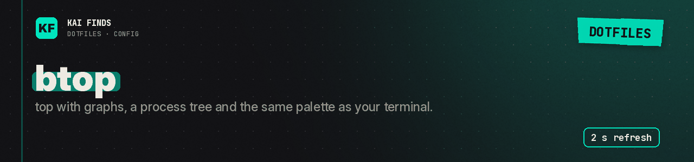

# btop: monitor resources

[← Home](../../../README.md) · [Upstream project: btop](https://github.com/aristocratos/btop) · [Detailed guide](../../../docs/guides/autres-outils.md)

btop is a terminal resource monitor. Our `btop.conf` picks Catppuccin Mocha, a transparent background, CPU, memory, network and process panels, the process tree, and a 2-second refresh.

The theme is `catppuccin_mocha`, shipped under `themes/`. Destination: `~/.config/btop/btop.conf`, theme under `~/.config/btop/themes/`. Install btop, then run `btop`. It shows the machine it runs on; no history ships with this repository.

`save_config_on_exit = true` saves your changes when btop quits. Those changes stay local; nothing syncs back here.

**✅ Worth it if**
- you want `top` with graphs, a process tree and the same palette as your terminal

**❌ Skip it if**
- you want your btop tweaks kept in Git: btop saves them locally on exit, and they drift from this file

## Apply these settings

Read the [installation guide](../../../docs/installation.md) and review the chezmoi diff before applying. READMEs stay in the repository; chezmoi never installs them.

---

<b>Kai Finds</b> · Do more with AI · <a href="https://github.com/Kai-Finds">github.com/Kai-Finds</a> · <a href="https://kaifinds.sabaidev.la">kaifinds.sabaidev.la</a>
