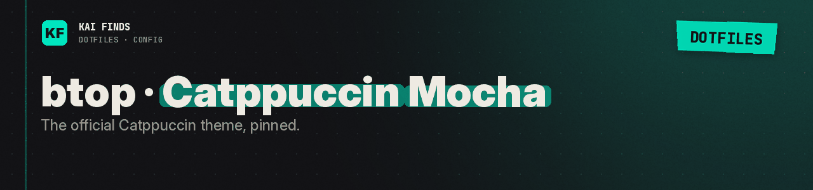

# btop · Catppuccin Mocha

[← Application configuration](../README.md) · [Upstream theme](https://github.com/catppuccin/btop)

`catppuccin_mocha.theme` is the official Catppuccin theme for btop. The parent `btop.conf` selects it with `color_theme = "catppuccin_mocha"`.

It is copied to `~/.config/btop/themes/`. Restart btop to load it. The background stays transparent and takes the terminal's color.

Pinned source versions: [theme-sources.json](../../../../docs/theme-sources.json). MIT notices: [docs/licenses/](../../../../docs/licenses/). The theme belongs to its upstream authors.

chezmoi does not install this README.

---

<b>Kai Finds</b> · Do more with AI · <a href="https://github.com/Kai-Finds">github.com/Kai-Finds</a> · <a href="https://kaifinds.sabaidev.la">kaifinds.sabaidev.la</a>
