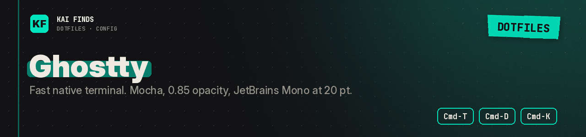

# Ghostty: window, theme, and shortcuts

[← Home](../../../README.md) · [Upstream project: Ghostty](https://ghostty.org/docs) · [Detailed guide](../../../docs/guides/ghostty.md)

Ghostty is the terminal window: tabs, splits and text rendering. Our `config` picks Catppuccin Mocha, 0.85 opacity, JetBrains Mono at 20 pt, and a steady block cursor.

| Keys | Setting |
| --- | --- |
| Cmd-T | New tab |
| Cmd-D | Split to the right |
| Cmd-Shift-D | Split downward |
| Cmd-Shift-← / → | Switch tabs |
| Cmd-K | Clear the screen |

The mouse moves focus, and selecting text copies it. Tune `font-size` and `background-opacity` until it reads well on your screen.

Destination: `~/.config/ghostty/config`. Install the app and fonts separately: the Brewfile declares Ghostty and a Nerd Font. The macOS options may not behave the same on Linux.

**✅ Worth it if**
- you want a fast native terminal with splits, and a see-through window that matches the rest of the setup

**❌ Skip it if**
- you live in tmux splits already and want an opaque window: drop `background-opacity` or skip the file

## Apply these settings

Read the [installation guide](../../../docs/installation.md) and review the chezmoi diff before applying. READMEs stay in the repository; chezmoi never installs them.

---

<b>Kai Finds</b> · Do more with AI · <a href="https://github.com/Kai-Finds">github.com/Kai-Finds</a> · <a href="https://kaifinds.sabaidev.la">kaifinds.sabaidev.la</a>
