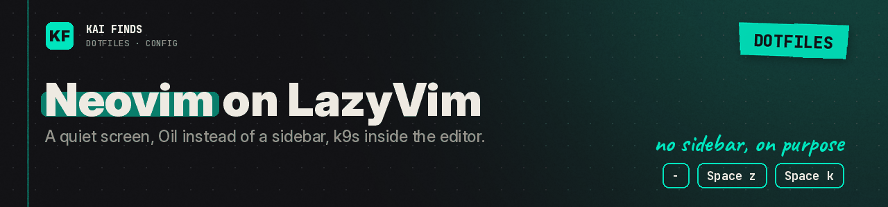

# Neovim: our LazyVim configuration

[← Home](../../../README.md) · [Upstream project: Neovim and LazyVim](https://www.lazyvim.org/) · [Detailed guide](../../../docs/guides/neovim.md)

Neovim is the editor. LazyVim brings a base of plugins and conventions. On top, we pick a transparent Catppuccin Mocha look, no lualine, no Snacks sidebar, and Oil to move around.

| File / directory | Role |
| --- | --- |
| `init.lua` | Loads `config.lazy` |
| `lua/config/` | lazy.nvim startup and editor options |
| `lua/plugins/` | Our plugin additions and overrides |
| `lazyvim.json` | Language, testing, debugging, and tooling extras |
| `lazy-lock.json` | Locked plugin versions |
| `stylua.toml` | Lua formatting |
| `LICENSE` | License retained from the original configuration |

In normal mode: `-` opens Oil, `Space z` toggles Zen, `Space k` opens k9s in a floating window. The features belong to the plugin authors. Our code picks and wires them.

First launch needs network access to download plugins. Language servers and tools have their own dependencies. Start on a throwaway file and run `:checkhealth`. The k9s integration also needs an authorized cluster context.

Destination: `~/.config/nvim`. The isolated test does not start Neovim or its plugins.

**✅ Worth it if**
- you like LazyVim but want a quieter screen: no status line, no sidebar, Oil instead
- you jump between code and Kubernetes and want k9s inside the editor

**❌ Skip it if**
- you rely on a file tree sidebar: it is off here, by design
- you want a config that has been launched in CI: the test checks the files, not a running Neovim

## Apply these settings

Read the [installation guide](../../../docs/installation.md) and review the chezmoi diff before applying. READMEs stay in the repository; chezmoi never installs them.

---

<b>Kai Finds</b> · Do more with AI · <a href="https://github.com/Kai-Finds">github.com/Kai-Finds</a> · <a href="https://kaifinds.sabaidev.la">kaifinds.sabaidev.la</a>
