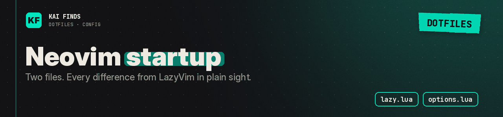

# Neovim: startup and options

[← Home](../../../../../README.md) · [Upstream project: LazyVim and lazy.nvim](https://www.lazyvim.org/configuration) · [Detailed guide](../../../../../docs/guides/neovim.md)

LazyVim sets the editor's base options. These two files keep our differences in plain sight.

| File | Our configuration |
| --- | --- |
| `lazy.lua` | Downloads lazy.nvim if absent, imports LazyVim then `plugins`, disables luarocks and automatic update checks |
| `options.lua` | `pumblend = 0`, `winblend = 0`, and `laststatus = 0` |

Zero blend keeps floating windows clean with the transparent theme. Hiding the status line takes two changes: `laststatus` here, and lualine off in `../plugins/ui.lua`.

lazy.nvim installs the plugins. Run `:Lazy check` to look for updates yourself. Check your LazyVim version's requirements before you call the first launch a success.

## Apply these settings

Read the [installation guide](../../../../../docs/installation.md) and review the chezmoi diff before applying. READMEs stay in the repository; chezmoi never installs them.

---

<b>Kai Finds</b> · Do more with AI · <a href="https://github.com/Kai-Finds">github.com/Kai-Finds</a> · <a href="https://kaifinds.sabaidev.la">kaifinds.sabaidev.la</a>
