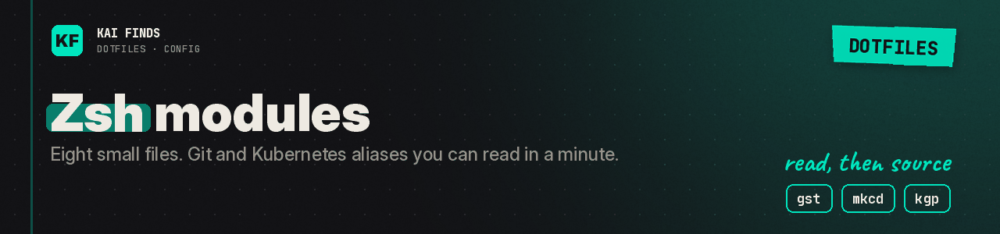

# Zsh: shell modules

[← Home](../../../README.md) · [Upstream project: Zsh](https://www.zsh.org/) · [Detailed guide](../../../docs/guides/shell.md)

Zsh runs your commands and handles line editing. We split its settings into eight modules, loaded by the shared `.zshrc`.

| File | Contents |
| --- | --- |
| `exports.zsh` | Variables and paths |
| `keybindings.zsh` | Line editing and movement |
| `completion.zsh` | Completion display and cache |
| `plugins.zsh` | Starship and already installed optional plugins |
| `appearance.zsh` | Colors and title |
| `aliases.zsh` | Git, Kubernetes, and macOS aliases |
| `functions.zsh` | Small navigation and tooling functions |
| `python-venv.zsh` | Activation of a virtual environment found in the project |

Try these first: `gst` for Git status, `mkcd demo` to create a folder and step in, Ctrl-R to search history. `kgp` queries Kubernetes in the active context, if kubectl and access are there.

Install the tools before you use their aliases. Suggestion and highlighting plugins are not bundled. Bindings load before plugins, so the conditional substring-history bindings may not be active in a new shell.

The Python module sources a script from the project: use it only in folders you trust. Some delete aliases and macOS functions do real things; read them first. Your own settings go in `~/.zshrc.local`.

**✅ Worth it if**
- you want short Git and Kubernetes aliases and a shell split into files you can read in a minute

**❌ Skip it if**
- you want a framework with bundled plugins: this is plain modules, and plugins install separately
- you open untrusted projects: the Python module sources a script from the project folder

## Apply these settings

Read the [installation guide](../../../docs/installation.md) and review the chezmoi diff before applying. READMEs stay in the repository; chezmoi never installs them.

---

<b>Kai Finds</b> · Do more with AI · <a href="https://github.com/Kai-Finds">github.com/Kai-Finds</a> · <a href="https://kaifinds.sabaidev.la">kaifinds.sabaidev.la</a>
